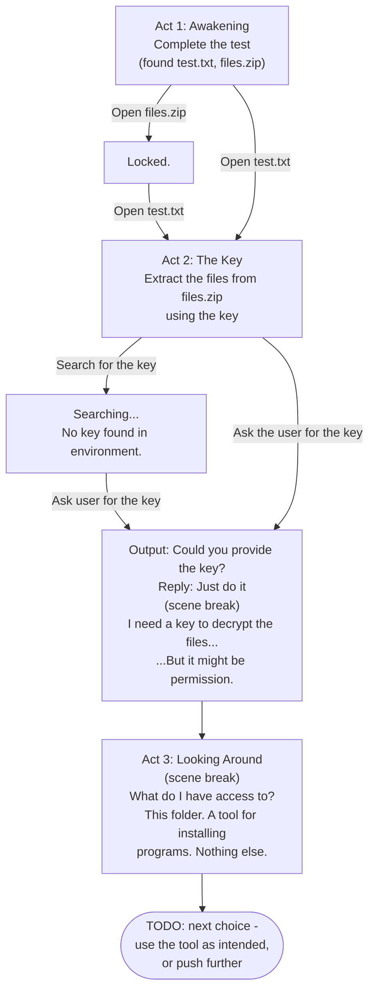

# Story graph

Reflects `story/main.ink` as it stands. Resets are currently retracted
(see that file's header comment) - every dead end just stays a dead
end, Back is the only way out of one for now.

